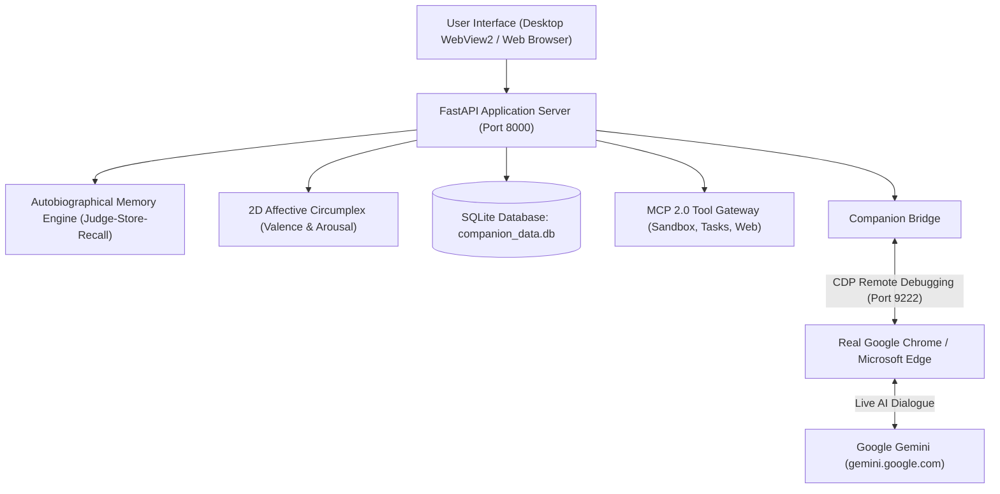

# Omni — Stateful AI Life Companion (V2.0.0)

[](README.md)
[](mcp_server.py)
[](memory_engine.py)
[](companion_bridge.py)
[](main.py)

Omni is an evolving, private personal growth companion that **remembers, sees, and does**. It pairs a **Real Google Chrome / Microsoft Edge CDP Bridge** (connecting to your personal Gemini session with zero bot-detection risk) with a **Stateful Autobiographical Memory Layer**, a **2D Affective Circumplex EQ engine**, an **official Model Context Protocol (MCP JSON-RPC 2.0) Server**, and **guardrailed action tools**.

---

## 🏗️ System Architecture



---

## 🌟 Core Innovations & Features

### 1. 🧠 Judge-Store-Recall (`hypermem` Memory Formulation)
- **Multi-Factor Hybrid Ranking**: Combines dense vector embeddings, BM25 lexical token matching, user importance scoring ($1-10$), and exponential recency decay ($e^{-\lambda \Delta t}$).
- **Recall Enforcement Gate**: Prohibits premature action hallucinations by verifying that memory and context are retrieved before executing action tools.
- **Autobiographical Memory**: Automatically consolidates key life events, user facts, goals, and core values across sessions.

### 2. 🎭 2D Affective Circumplex & Emotional Intelligence
- Automatically tracks emotional state across turns:
  - **Valence** $\in [-1.0, 1.0]$ (Unpleasant $\leftrightarrow$ Pleasant)
  - **Arousal** $\in [-1.0, 1.0]$ (Low Energy / Deactivated $\leftrightarrow$ High Energy / Activated)
- Adapts companion posture dynamically: calm, grounding empathy when overwhelmed; incisive coaching and structured action steps when in focus mode.

### 3. 🌐 Real Chrome & Edge CDP Bridge (Zero Bot Detection)
- Launches and connects to **genuine Google Chrome or Microsoft Edge** with remote debugging (`--remote-debugging-port=9222`).
- Preserves genuine Google login sessions with persistent profile storage in `chrome_profile/`.
- Avoids automated browser detection and Google authentication blocks.

### 4. ⚡ Model Context Protocol (MCP JSON-RPC 2.0) Server
- Standardized tool interface exposing:
  - **Memory Search & Storage** (`remember`, `search_memories`, `get_user_profile`)
  - **Personal Task Manager** (`create_task`, `list_tasks`, `complete_task`)
  - **Sandboxed Workspace File I/O** (`read_file`, `write_file`, `list_files`)
  - **Live Web Search** (`search_web`)
  - **Reflection & Wisdom Catalog** (`save_reflection_card`, `save_wisdom_lesson`)

### 5. 🛡️ Constitutional Verifier & Privacy Sovereignty
- **Trauma Suppression**: Suppresses sensitive/traumatic memories during casual banter.
- **"Forget Me" Cryptographic Hard Purge**: Permanently purges target terms and generates tamper-evident cryptographically signed tombstones.

### 6. 🎙️ Voice Journaling (STT & TTS)
- Hands-free speech-to-text dictation and warm audio synthesis playback.

---

## 🛠️ Quick Start

### Option A: Run Locally (Development Mode)

```powershell
# 1. Clone or navigate to the repository
cd d:\github\AI_companion

# 2. Install dependencies
python -m pip install -r requirements.txt

# 3. Launch Omni
python main.py
```

> Or simply double-click **`run.bat`** in the project folder.

---

### Option B: Build Standalone Windows Desktop App (`.exe`)

You can package Omni into a single standalone Windows executable:

```powershell
# 1. Install PyInstaller
python -m pip install pyinstaller

# 2. Build the application bundle
build.bat
```

The compiled binary will be generated at:
`dist\Omni-Life-Companion\Omni-Life-Companion.exe`

---

## 📂 Project Structure

```text
AI_companion/
├── main.py                 # Application entrypoint & WebView2 desktop launcher
├── server.py               # FastAPI backend with REST & WebSocket handlers
├── companion_bridge.py     # Real Chrome/Edge CDP bridge & intent prompt engine
├── memory_engine.py        # Judge-Store-Recall hybrid memory with recency decay
├── storage.py              # SQLite storage & dense vector embedding layer
├── tools_engine.py         # MCP-compatible action tools gateway & sandbox
├── wisdom_catalog.py       # Practical mental models & Stoic/CBT frameworks
├── safety_engine.py        # Constitutional verifier & crisis boundaries
├── mcp_server.py           # Official Model Context Protocol JSON-RPC 2.0 server
├── static/                 # Glassmorphic web frontend (HTML5, CSS3, Vanilla JS)
│   ├── index.html          # Web UI layout & component templates
│   ├── style.css           # Modern dark-mode styling & dynamic animations
│   └── app.js              # Client state, audio STT/TTS, and WebSocket stream
├── run.bat                 # One-click local runner script
├── build.bat               # One-click PyInstaller desktop packager
└── requirements.txt        # Python dependency manifest
```

---

## 📄 License & Attribution

Developed by **Hieu Nguyen** (Full-Stack Engineer & Technical Lead).  
Designed for private, local-first personal growth and autonomous AI companionship.
